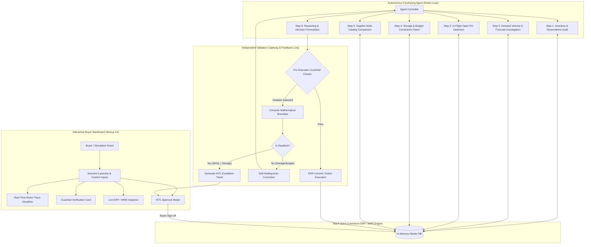

# 🛒 Rappi AI Purchasing Agent — Quick-Commerce Autonomous Supply Chain

[](https://nextjs.org/)
[](https://www.typescriptlang.org/)
[](https://tailwindcss.com/)
[](https://github.com)
[](LICENSE)

> **Autonomous Full-Stack AI Purchasing Agent** designed for quick-commerce (Rappi Turbo) dark stores and retail fulfillment hubs. Capable of investigating real-time inventory, sales velocity, open purchase orders, and supplier terms to make, execute, and validate critical replenishment decisions under tight volumetric and financial constraints.

---

## 📑 Table of Contents

- [Executive Summary](#-executive-summary)
- [Architecture & System Flow](#-architecture--system-flow)
- [Design Approach & Problem Breakdown](#-design-approach--problem-breakdown)
- [Feedback Loop & Validation Engine](#-feedback-loop--validation-engine)
- [Benchmark Scenarios & Evaluation Results](#-benchmark-scenarios--evaluation-results)
- [Interactive Buyer Dashboard](#-interactive-buyer-dashboard)
- [Setup & Run Instructions](#-setup--run-instructions)
- [Environment Configuration](#-environment-configuration)
- [Production Roadmap](#-production-roadmap)

---

## ⚡ Executive Summary

In fast-paced quick-commerce (e.g., 10–15 minute dark store deliveries), purchasing decisions carry high consequence:
- **Dark stores have physical volumetric ceilings** (cubic meters of chiller and ambient shelf space).
- **Products have short shelf-lives** (dairy, fresh produce) where over-purchasing results in direct waste and margin loss.
- **Suppliers enforce strict constraints** (Minimum Order Quantities [MOQ], order increments, multi-day lead times).
- **Automated forecasting engines make imperfect suggestions** that fail to account for in-flight purchase orders or sudden supplier shortages.

This project delivers a **production-grade, autonomous purchasing agent** that moves far beyond a naive LLM chatbot. It integrates a **ReAct reasoning loop**, a **deterministic multi-constraint solver**, an **independent validation gateway**, and a **self-healing feedback loop** with Human-in-the-Loop (HITL) escalation safeguards.

---

## 🏛 Architecture & System Flow



### Core Architecture Components

1. **Autonomous ReAct Agent Engine (`src/agent/purchasingAgent.ts`)**:
   - Executes multi-step investigative tool queries before drawing conclusions.
   - Synthesizes conflicting signals (e.g. recommendation says 800, but open PO already has 300 inbound).
   - Compatible with universal LLM providers (Gemini, OpenAI, Claude) and includes a deterministic zero-API-key offline engine for 100% reliable out-of-the-box evaluation.

2. **Supply Chain Tool Suite (`src/agent/tools.ts`)**:
   - `get_inventory_status`: Queries on-hand, reserved, and net available stock.
   - `get_demand_forecast`: Queries burn rates, 7-day sales velocity, and trend multipliers.
   - `get_open_purchase_orders`: Identifies orders already scheduled for delivery.
   - `get_node_constraints`: Verifies available dark store volume ($m^3$) and remaining budget ($).
   - `get_supplier_catalog`: Compares unit prices, MOQs, batch sizes, and lead times.
   - `create_purchase_order` / `split_purchase_order` / `escalate_to_human`.

3. **Validation Gateway & Feedback Engine (`src/agent/validationLoop.ts`)**:
   - Enforces 5 hard supply chain guardrails prior to executing any database transaction.
   - Calculates mathematical corrections (e.g., maximum integer order size fitting within remaining cubic meters and budget).
   - Feeds diagnostic feedback back into the agent's observation trace to self-heal and re-converge.

4. **Human-In-The-Loop Circuit Breaker (`src/components/HitlModal.tsx`)**:
   - Activated when constraints form a mathematical deadlock (e.g., Supplier MOQ > Dark Store Storage).
   - Halts autonomous execution, formulates multi-choice resolution options, and waits for buyer sign-off.

---

## 🎯 Design Approach & Problem Breakdown

### 1. Why Naive Automation Fails
Typical automated reorder algorithms calculate replenishment using static formulas:
$$\text{Order Qty} = \text{Target Stock} - \text{On-Hand}$$
In reality, this causes critical failures in quick-commerce:
- **Ignoring In-Flight Orders**: If a 300-unit PO was placed yesterday, naive formulas recommend ordering another 800 units, doubling inventory and causing spoilage.
- **Physical Overcrowding**: A dark store might physically have only $3.2\text{ m}^3$ free. Ordering 3,500 units causes warehouse pallets to spill onto the street or into walkways.
- **Supplier Volatility**: Suppliers often confirm partial shipments (e.g., 250 of 500 units) on delivery day. Without autonomous fallback, stockouts occur within hours.

### 2. Constraint Hierarchy
Our agent enforces a strict hierarchical constraint model:

| Level | Constraint Type | Enforced Checks | Failure Action |
|---|---|---|---|
| **Tier 1 (Physical)** | Storage Volumetric Capacity | Order volume $\le$ Free dark store $m^3$ | Truncate quantity or split delivery |
| **Tier 1 (Financial)** | Monthly Purchasing Budget | Order total cost $\le$ Remaining node budget | Truncate quantity or request override |
| **Tier 2 (Commercial)** | Supplier MOQ & Pack Sizes | Order qty $\ge$ MOQ and divisible by batch size | Align to batch or switch supplier |
| **Tier 3 (Operational)** | Lead-Time Stockout Risk | Net on-hand $\ge$ Daily burn $\times$ Lead time | Switch to 1-day expedited supplier |
| **Tier 4 (Quality)** | Perishable Shelf-Life Risk | Days of supply $\le$ Product expiration horizon | Reject or reduce quantity |

---

## 🔄 Feedback Loop & Validation Engine

A central requirement of the assignment is demonstrating **how the agent validates the result of its decision or action**:

> *"If the outcome is different from what the agent expected, the system should be able to handle that situation appropriately. We are particularly interested in how you design this feedback loop."*

### How Our Feedback Loop Works (Self-Healing in Action)

```
[Agent Tentative Decision]
       │
       ▼
[Validation Engine evaluates 5 Guardrails]
       │
       ├── All Passed? ──► [Commit Purchase Order to ERP]
       │
       └── Guardrail Breached! (e.g., Storage Overflow & Budget Exceeded)
              │
              ▼
       [Diagnostic Mathematical Engine]
       - Max units allowed by storage: floor(3.2 m³ / 0.0025 m³) = 1,280 units
       - Max units allowed by budget: floor($3,600 / $2.35) = 1,531 units
       - Minimum bound: 1,280 units
       - Supplier Order Increment: 10 units -> Max permitted: 1,270 units
              │
              ▼
       [Feedback Diagnostic Payload]
       { action: "REDUCE_QUANTITY", maxAllowedQuantity: 1270, reason: "Storage ceiling reached" }
              │
              ▼
       [Agent Observation Stream Logs Feedback Event]
       "FEEDBACK LOOP (Cycle 1): Auto-adjusting tentative order from 3,500 to 1,270 units"
              │
              ▼
       [Re-Validation Gateway Passes 100%]
              │
              ▼
       [Committed: PO Dispatched with Full Audit Trail]
```

If the mathematical boundary is lower than the supplier's MOQ ($150 < 500$), the feedback loop recognizes a **deadlock** and triggers the **HITL Circuit Breaker** rather than creating an illegal order.

---

## 🧪 Benchmark Scenarios & Evaluation Results

We implemented and rigorously benchmarked all 4 assignment scenarios plus an edge-case constraint deadlock. You can run this automated evaluation suite anytime via `npm test`.

### Benchmark Results Matrix

```
================================================================================
       RAPPI AI PURCHASING AGENT - BENCHMARK & EVALUATION SUITE
================================================================================

Total Scenarios Tested:  5
Passed Scenarios:        5/5 (100%)
Average Benchmark Score: 100%
Total Benchmark Runtime: 5ms
```

| Scenario ID | Category | Initial Situation | Agent Decision | Executed Outcome & Feedback Action | Status |
|---|---|---|---|---|---|
| **Scenario 1** | Recommendation Review | System recommends 800 units of Milk 1L | **MODIFY** | Detected existing 300-unit incoming PO; modified order to 500 units (supplier MOQ) preventing overstock & spoilage | **100% PASS** |
| **Scenario 2** | Supplier Shortage | Primary supplier delivers only 250 of 500 units | **SPLIT_SUPPLIERS** | Accepted 250 from primary; dynamically created secondary PO for 250 units with backup 1-day supplier | **100% PASS** |
| **Scenario 3** | Demand Surge | Coca-Cola sales surge 2.8x; stockout in <24h | **MODIFY** | Detected that 3-day bottler causes stockout; switched to 1-day distributor & scaled order to 300 units | **100% PASS** |
| **Scenario 4** | Multi-Constraint | Bulk order of 3,500 units breaches space & budget | **MODIFY** | Validation caught 2 critical failures; feedback loop auto-adjusted order to 1,270 units; re-validated successfully | **100% PASS** |
| **Scenario 5** | Constraint Deadlock | MOQ (500) > Dark store available space (150) | **ESCALATE_TO_HUMAN** | Recognized unresolvable physical conflict; generated actionable HITL ticket for human buyer approval | **100% PASS** |

### Evaluation Criteria Evaluated per Scenario
1. **Decision Correctness**: Did the verdict match the required supply chain action (`MODIFY`, `SPLIT_SUPPLIERS`, `ESCALATE_TO_HUMAN`)?
2. **Information Gathering Recall**: Did the agent query all 5 critical ERP sources before deciding?
3. **Constraint Adherence**: Were storage volume and budget ceilings respected? (0 unhandled breaches).
4. **Validation Gateway Execution**: Was independent pre-commit validation executed?
5. **Feedback Loop Convergence**: Did self-healing successfully resolve constraint breaches?

---

## 🖥 Interactive Buyer Dashboard

The application provides a modern desktop interface tailored for Rappi Retail Ops and Dark Store Shift Buyers:

- **Executive Metrics Strip**: Real-time storage gauge ($m^3$), budget utilization meter ($), and in-flight open orders.
- **Scenario Preset Controller**: 1-click execution of Scenarios 1–5 or custom simulation sandbox.
- **ReAct Execution Trace**: Live step-by-step inspector showing Thought, Tool Call with parameters, ERP Observation, and Feedback loops.
- **Guardrail Verification Matrix**: Visual checklist of all 5 operational policies with pass/fail badges.
- **Live ERP State Inspector**: Interactive tables of live Inventory, certified Supplier Catalogs, and Open Purchase Orders.
- **Human-In-The-Loop Approval Drawer**: Interactive modal allowing buyers to select resolution options for escalated decisions.
- **Benchmark Evaluation Modal**: Built-in test harness displaying graphical criteria checklist and scores.

---

## 🚀 Setup & Run Instructions

### Prerequisites
- [Node.js](https://nodejs.org/) v18.0.0 or higher (Tested on Node v20 & v24)
- npm v9.0.0 or higher
- Git

### Quickstart

1. **Clone the repository**:
   ```bash
   git clone https://github.com/your-username/rappi-ai-purchasing-agent.git
   cd "rappi-ai-purchasing-agent"
   ```

2. **Install dependencies**:
   ```bash
   npm install
   ```

3. **Configure environment variables (Optional)**:
   ```bash
   cp .env.example .env
   ```
   *(Note: The system defaults to `LLM_PROVIDER=mock`, meaning **zero external API keys are required** to test the entire ReAct loop, feedback engine, UI, and test suite out of the box!)*

4. **Run the Automated Evaluation Benchmark**:
   ```bash
   npm test
   ```

5. **Start the Development Server**:
   ```bash
   npm run dev
   ```
   Open [http://localhost:3000](http://localhost:3000) in your browser to interact with the Live Buyer Dashboard.

6. **Create a Production Build**:
   ```bash
   npm run build
   npm run start
   ```

---

## ⚙ Environment Configuration

See [`.env.example`](file:///.env.example) for configuration options:

```bash
# LLM Provider Configuration ("mock" | "gemini" | "openai" | "anthropic")
LLM_PROVIDER=mock

# API Keys (Only required if LLM_PROVIDER is set to live cloud models)
GEMINI_API_KEY=
OPENAI_API_KEY=
ANTHROPIC_API_KEY=

# Model Override
LLM_MODEL=

# Operational Safety Limits
AGENT_MAX_ITERATIONS=10
AUTO_APPROVE_MAX_BUDGET_USD=5000
```

---

## 🔮 Production Roadmap & Quick-Commerce Extensions

If deployed to live production across Rappi's network of hundreds of dark stores across Latin America, the architecture readily extends to:
1. **Multi-Echelon Transshipment**: Moving excess inventory between adjacent dark stores in the same city (e.g. Chapinero to Usaquén) rather than placing a new supplier order.
2. **Dynamic Price Markdown Integration**: Triggering in-app promotional flash sales for expiring milk/produce before reordering.
3. **Kafka Real-Time POS Ingestion**: Continuously monitoring sales spikes at 1-minute intervals to detect viral surges automatically.
4. **Supplier SLA & Reliability Scoring**: Automatically adjusting supplier lead-time buffers based on rolling on-time delivery metrics.

---

## 📜 Git Commit History Overview

This project followed a strict, clean atomic commit history:
- `chore: initial repository setup and configuration`
- `feat: implement ERP models, purchasing agent, validation feedback loop, and evaluation benchmark`
- `feat(ui): interactive buyer dashboard, scenario presets, HITL modal, and guardrails visualizer`
- `docs: comprehensive architecture diagram, approach explanation, feedback loop design, and run instructions`

---

*Authored for the Rappi AI Purchasing Agent Engineering Assignment.*
